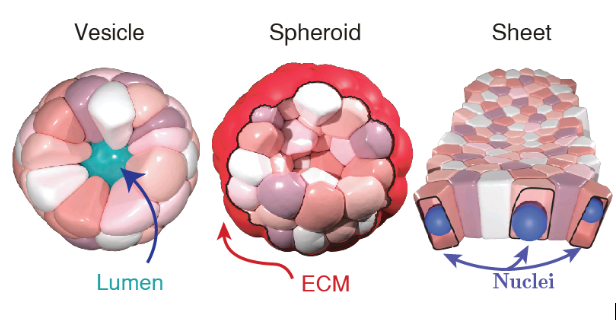

# SimuCell3D

[](https://github.com/nilesh-patil/simucell3d/actions/workflows/ci.yml)
[](https://nilesh-patil.github.io/simucell3d/stable/)
[](./LICENSE)
[](https://doi.org/10.1038/s43588-024-00620-9)

SimuCell3D simulates the mechanics of three-dimensional tissues at subcellular resolution.
Each cell is a closed, triangulated surface whose shape follows from its volume, surface
tension, area elasticity and bending energy, and from adhesion and repulsion at contacts with
neighbouring cells. The faces of a cell can belong to different membrane domains (for example
apical, lateral and basal) with their own mechanical parameters, so that cell polarization can be
modelled. Besides epithelial cells, a tissue can contain nuclei, extracellular matrix (ECM),
lumens and static obstacles. Cells grow, divide and are removed during a simulation.

SimuCell3D was created by Steve Runser in the Iber Lab (ETH Zurich) and is described in
Runser, Vetter & Iber, *Nature Computational Science* **4**, 299-309 (2024),
[doi:10.1038/s43588-024-00620-9](https://doi.org/10.1038/s43588-024-00620-9).

<p align="center">
  
</p>

**Documentation: <https://nilesh-patil.github.io/simucell3d/>**

> **Results differ from 1.0.** SimuCell3D 2.1 fixes bugs in the 1.0 code published with the
> paper, and these fixes change simulation results. It also adds safeguards that remove
> numerically unstable cells during long runs. To compare with the published figures, use
> release 1.0 (tag `v1.0`, archived at
> [doi:10.5281/zenodo.10796908](https://doi.org/10.5281/zenodo.10796908)). See
> [CHANGELOG.md](./CHANGELOG.md) for the changes and the known issues.

## Requirements

- Linux, or Windows through WSL
- A C++17 compiler with OpenMP (GCC 10 or newer)
- CMake 3.10 or newer

Alternatively, the `Dockerfile` builds the program in a container.

## Build

```bash
git clone https://github.com/nilesh-patil/simucell3d.git
cd simucell3d
mkdir build && cd build
cmake -DCMAKE_BUILD_TYPE=Release ..
make -j4
./simucell3d --version
```

The executable is `build/simucell3d`. The Python module is built with
`-DENABLE_PYTHON_BINDINGS=TRUE`. Docker and other options are described in the
[installation guide](https://nilesh-patil.github.io/simucell3d/stable/install.html).

## Run a simulation

A simulation is defined by an XML parameter file, which names the input mesh (a legacy VTK file)
and the output folder. From the `build/` directory:

```bash
./simucell3d ../parameters/core/parameters_vesicle_quick.xml
```

This runs 200 time steps of an epithelial vesicle of 432 cells around a lumen. The output folder
named in the parameter file (here `simulation_results/simulation_vesicle/` in the repository
root) is **deleted and recreated** at the start of every run. It receives:

- `cell_data/result_<n>.vtk` and `face_data/result_<n>.vtk`: the tissue at each sampling time,
  for viewing in [ParaView](https://www.paraview.org/);
- `simulation_statistics.csv`: per-cell geometry and energies over time;
- `performance_diagnostics.csv`: timing and solver diagnostics every 100 iterations.

Command-line options:

| Option | Meaning |
|---|---|
| `--threads=N` | Number of OpenMP threads (default: one per physical core, pinned) |
| `--schedule=MODE` | OpenMP scheduling: `adaptive` (default), `static`, `dynamic`, `guided` |
| `--output-dir=PATH` | Write output to `PATH` instead of the folder in the parameter file |
| `--diagnostics-csv=PATH` | Write the diagnostics CSV to `PATH` |
| `--version` | Print the version and exit |

The contact model, the dynamic model and the polarization mode are compile-time options in
`include/global_configuration.hpp`. Each shipped parameter file states the configuration it was
written for in its header comment.

## Documentation

- [Installation](https://nilesh-patil.github.io/simucell3d/stable/install.html)
- [Getting started](https://nilesh-patil.github.io/simucell3d/stable/getting_started.html):
  a first simulation and its output
- [User guide](https://nilesh-patil.github.io/simucell3d/stable/user_guide/index.html):
  the model, the parameter file, input meshes, output files, the Python module
- [Examples](https://nilesh-patil.github.io/simucell3d/stable/examples/index.html):
  one page per shipped parameter file
- [API reference](https://nilesh-patil.github.io/simucell3d/stable/api/index.html)
- [Developer guide](https://nilesh-patil.github.io/simucell3d/stable/developers/index.html)
- [Release history](https://nilesh-patil.github.io/simucell3d/stable/whats_new/index.html)
  and [CHANGELOG.md](./CHANGELOG.md)

The documentation sources are in [`doc/`](./doc/).

## Citation

If SimuCell3D contributes to a publication, please cite:

> Runser, S., Vetter, R. & Iber, D. SimuCell3D: three-dimensional simulation of tissue
> mechanics with cell polarization. *Nat. Comput. Sci.* **4**, 299-309 (2024).
> https://doi.org/10.1038/s43588-024-00620-9

```bibtex
@article{runser2024simucell3d,
  author  = {Runser, Steve and Vetter, Roman and Iber, Dagmar},
  title   = {{SimuCell3D}: three-dimensional simulation of tissue mechanics with cell polarization},
  journal = {Nature Computational Science},
  volume  = {4},
  pages   = {299--309},
  year    = {2024},
  doi     = {10.1038/s43588-024-00620-9}
}
```

[`CITATION.cff`](./CITATION.cff) gives the same reference in machine-readable form, together with
the software version.

## Contributing

Bug reports and pull requests are welcome; see [CONTRIBUTING.md](./CONTRIBUTING.md).

## License

BSD 3-Clause License, copyright (c) 2024, ETH Zurich (Steve Runser and the Iber Lab).
See [LICENSE](./LICENSE).
