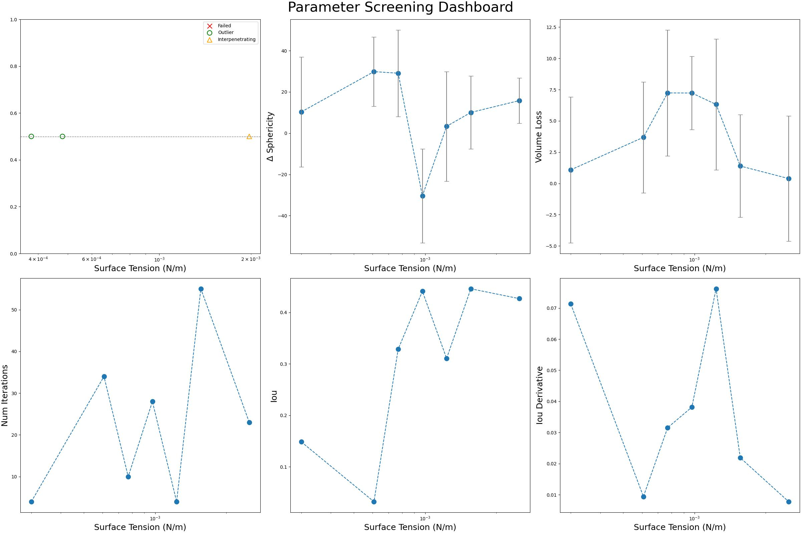
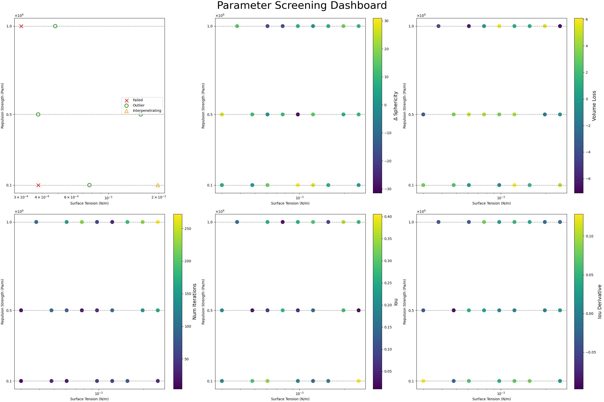
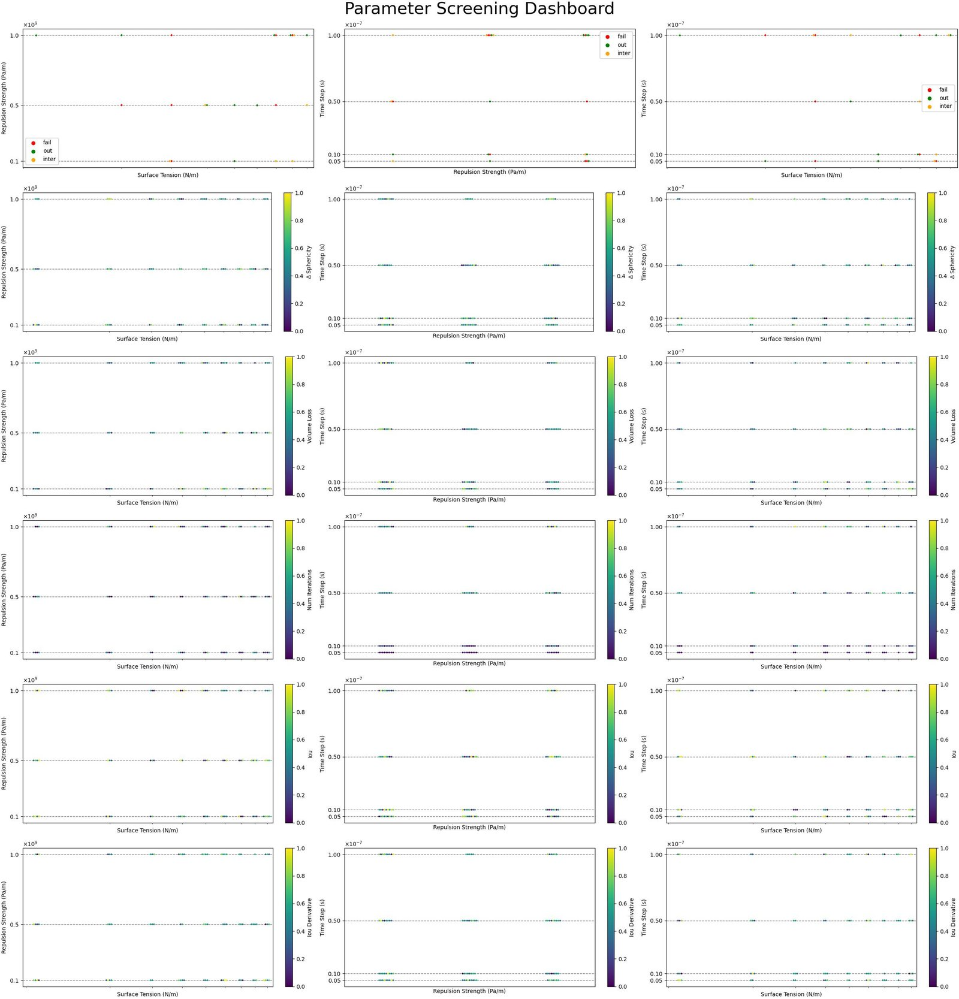
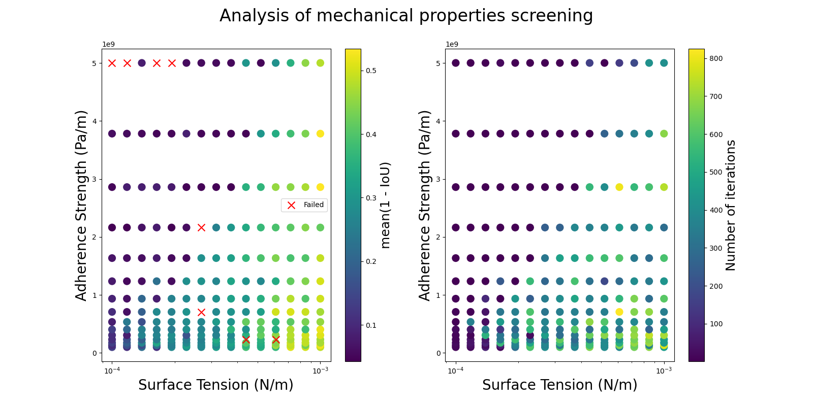

# Screening analysis scripts

Scripts that compute summary metrics for every run of a parameter screen (made with
`scripts/parameter_screening/`) and plot them as dashboards against the screened parameters.

The full description is in the user guide, chapter "Parameter screening", section "Analysing a
screen"
([`doc/user_guide/17_parameter_screening.md`](../../doc/user_guide/17_parameter_screening.md),
published at <https://nilesh-patil.github.io/simucell3d/stable/user_guide/17_parameter_screening.html>).

## Contents

| Path | Purpose |
|---|---|
| `run_data_collection.py` | Submits four Slurm jobs that compute the metrics (`utils/compute_*.py`) into `<screen folder>/dashboard_files/`. Set `root_dir` and `screening_csv_file_name` in its `__main__` section. |
| `screening_dashboard.py` | Draws the dashboard into `<screen folder>/dashboard_plots/`. Set the metrics, the screened parameters, their axis scales and the paths in its `__main__` section. |
| `preprocess_dashboard_data.py` | Functions used by `screening_dashboard.py` to load and merge the metric files. |
| `mech_props_analysis.py` | Reduced dashboard for screens over surface tension and adherence strength: `python3 mech_props_analysis.py <simulation_outputs> <table.csv> <output folder>`. |
| `utils/` | Metric computations (sphericity, volume loss, intersection over union, interpenetration, number of output files) and mesh helpers. |
| `additional/` | Helpers for single runs: empty output files, sphericity and volume over time, copying files from the cluster. |
| `misc/` | `param2table.json` maps dashboard parameter names to table columns; `param2unitofmeas.json` gives their units. |
| `test_data/` | Synthetic screening results for one, two and three parameters, and the script that generates them. |
| `requirements.txt` | Python packages: `pip install -r requirements.txt`. |

Run the scripts from this directory. `run_data_collection.py` and `screening_dashboard.py`
read the parameter table from `<screen folder>/summary_folder/<table>.csv`, the folder that
`scripts/parameter_screening/collect_screening_data.py` creates.

## Dashboards

The dashboard layout depends on the number of screened parameters:

| One parameter | Two parameters | More than two parameters |
|---|---|---|
|  |  |  |

Output of `mech_props_analysis.py`:

